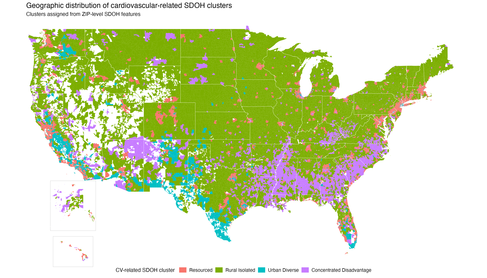

# ARCSDOCVH

<!-- badges: start -->
<!-- badges: end -->

`ARCSDOCVH` provides ZIP-level cardiovascular-related social determinants of health (SDOH) cluster assignments for U.S. ZIP/ZCTA areas.

The main dataset is `df_zip_cluster_kmeans_cv`, which contains ZIP-level contextual variables, final K-means cluster assignments, and a distance-based assigned-cluster confidence score.

The package is designed as a small data package. It allows users to load the final ZIP-level SDOH cluster dataset, inspect the data dictionary, access a pre-generated map, and optionally recreate the map using Census ZCTA boundaries.

## Installation

You can install the development version of `ARCSDOCVH` from GitHub with:

```r
# install.packages("remotes")
remotes::install_github("lpetito/ARC-SDOCVH")
```

## Load the package

```r
library(ARCSDOCVH)
```

## Main dataset

The primary dataset is:

```r
df_zip_cluster_kmeans_cv
```

It contains one row per ZIP/ZCTA area and includes:

- ZIP code identifier
- ZIP/ZCTA-level SDOH variables
- final K-means cluster assignment
- assigned-cluster confidence score

```r
dim(df_zip_cluster_kmeans_cv)
head(df_zip_cluster_kmeans_cv)
```

## Get cluster data with burden labels

The helper function `get_cluster_data()` returns the main dataset and adds the interpreted SDOH burden label.

```r
dat <- get_cluster_data()

head(dat)
table(dat$burden_sdoh)
```

The raw K-means cluster labels are mapped as follows:

| K-means cluster | SDOH burden label |
|---:|:---|
| 2 | Low |
| 1 | Moderate |
| 4 | High |
| 3 | Very High |

## Data dictionary

The package includes a machine-readable data dictionary:

```r
sdoh_zip_clusters_dictionary
```

A CSV version is also installed with the package:

```r
system.file(
  "extdata",
  "sdoh_zip_clusters_dictionary.csv",
  package = "ARCSDOCVH"
)
```

## Supplemental table

The package includes an Excel version of Supplemental Table 1, which describes the variables included in creation of the burden of cardiovascular-related SDOH clusters.

```r
supplemental_table_file()

readxl::read_excel(supplemental_table_file())
```

## Map

A pre-generated map is included with the package.

```r
cluster_map_file()
```

The map can also be recreated in R:

```r
p <- plot_cluster_map()
p
```

The first run of `plot_cluster_map()` may take longer because it downloads Census ZCTA and state boundary files through `tigris`.



## Notes on interpretation

The variable `cluster_kmeans` stores the final K-means cluster assignment.

The variable `assigned_prob_kmeans` is a distance-based assigned-cluster confidence score. It is not a model-based posterior probability.

The package contains ZIP/ZCTA-level contextual variables and cluster assignments. It should not include patient-level data or restricted registry data.
